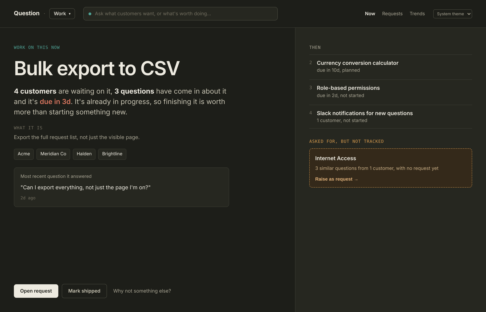
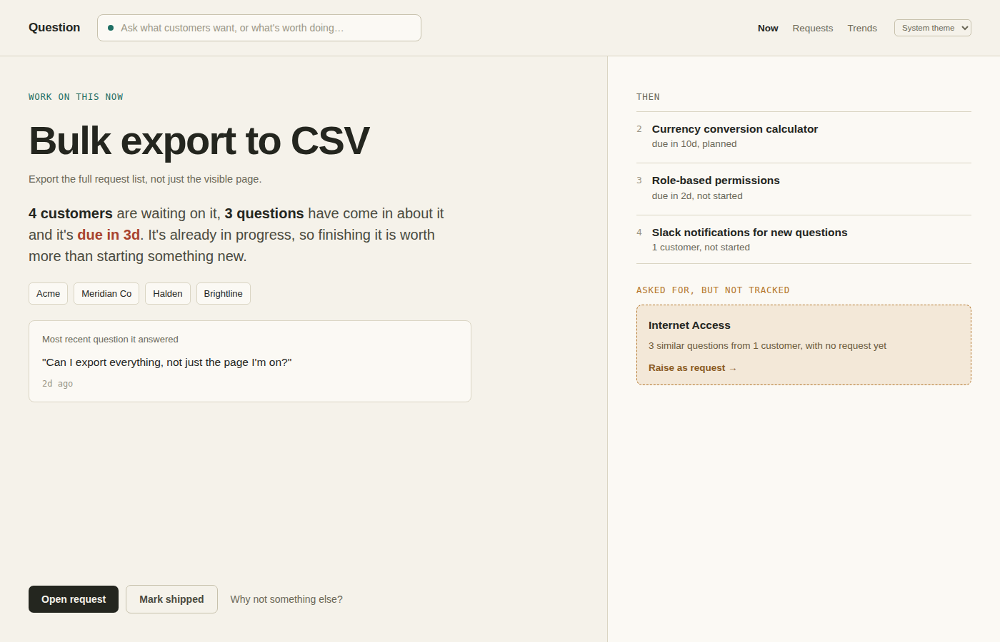

# Question

> [!NOTE]
> Current status - Beta testing

A lightweight desktop tool for product managers to keep feature requests and
customer questions in one, low overhead system: track who's asking for what, spot
duplicate asks before they become duplicate work, see which topics keep
coming up, and know what to work on next.

<p>
  
  
</p>

The **Now** screen above answers one question directly — "what should I work
on next, and why?" — as a single recommendation with the reasoning spelled
out in plain language, rather than a sortable table you have to interpret
yourself.

## What it does

- **Now** — the single most important request to work on, with the reasons
  (customers waiting, questions asked, due date, current status) written out
  as a sentence, plus what's next in line and any recurring "asked for, but
  not tracked" theme. Backed by the same adjustable priority score as
  before (urgency, customer count, question volume, age, due-date
  proximity) — open a request to see the full breakdown and adjust the
  weights.
- **Ask box** (in the header, on every screen) — type a question, a
  customer or topic name, or a quarter, and get an answer screen back: a
  match against an existing request (with a one-click way to count your ask
  and bump its rank), a recurring theme if others have asked something
  similar, confirmation that a brand-new question was logged, or a
  quarter/customer/topic breakdown as grouped cards. Every question is
  logged either way — nothing is thrown away, and nothing sits in a visible
  backlog until it's actually a repeated theme.
- **Requests** — every feature request in one list, with Group by
  (quarter/urgency/topic/none) and Layout (list, or a "ledger" view that
  draws the priority score as a stacked bar of its parts) controls instead
  of a fixed set of tabs. A shipped filter (hidden/included/only) and
  saveable named presets ("Views") replace the old per-tab settings.
- **Feature requests** — track status, urgency, topic, quarter, customers,
  and due date per request; raise a request straight from a logged question
  (or a whole recurring theme at once) so duplicates get merged instead of
  re-created.
- **Questions** — log customer questions, match them to an existing request
  or leave them unmatched, and see which topics have unanswered questions
  piling up.
- **Trends** — cross-cutting views across requests and questions, led with
  recurring themes without a tracked feature yet: which tracked features
  get asked about most (flagging one that shipped but is still generating
  questions — a discoverability problem, not a missing-feature one),
  requests shared by more than one customer, and customers asking for more
  than one thing.
- **Custom statuses & topics** — rename or delete the values you added,
  the same way for both.
- **Light / dark / system theme.**

## How question matching works

Typing into the ask box tries, in order: an exact customer/topic/quarter
lookup, then a match against logged requests and previously-answered
questions, then (if it looks like "raise a feature request for...") a new
draft. The request/question match is plain keyword overlap — it stems your
words and counts how many also appear in a request's title and description
(or a previously-answered question's text) — not a semantic or AI match, so
it only finds things that share actual vocabulary with what you typed.

**Works well:**
- "Does the currency calculator support GBP?" → matches a request titled
  *Currency conversion calculator* on shared words like "currency"/"calculator".
- Typing a topic or customer name on its own, e.g. "Travel" or "Meridian Co"
  → lists every request under that topic or customer, rather than guessing
  one.

**Won't match:**
- A question that's conceptually about a topic but doesn't share any words
  with the requests in it — e.g. three Travel requests titled "Narribri",
  "Coffs Harbour", "London" won't match "Where do I want to travel to?",
  because none of those titles contain the word "travel" (and topic names
  are deliberately excluded from matching — see below).
- Paraphrases and synonyms in general — "Is dark theme available?" only
  matches a request literally about "dark" + "theme", not one about, say,
  "night mode".

**Why topic name isn't part of the match:** several requests can share one
topic, so if the topic word alone counted, a question merely containing
that word would arbitrarily "win" against one of them — a false-positive
pick when the honest answer is "here are all of them." That's exactly what
the topic/customer lookup above is for instead.

**In practice:** if you want every request under a topic rather than a
single guessed match, just type the topic's name (or the customer's name)
on its own.

The reasoning behind this and other non-obvious choices in the app is kept
in [docs/DESIGN.md](docs/DESIGN.md) — worth a look before "fixing" behavior
that turns out to be deliberate.

## How it's built


- **Renderer**: a single-file HTML/CSS/JS UI (`renderer/index.html`), no
  framework, no build step.
- **Backend**: plain Node.js (`src/backend.cjs`). Every request and question
  is a human-readable Markdown file with YAML frontmatter under `data/` —
  that's the actual source of truth, and it's yours: back it up, sync it,
  read it in a text editor, put it in your own git repo if you want.
- **Index**: a SQLite file (`data/index.sqlite`, via Node's built-in
  `node:sqlite`) is rebuilt from those Markdown files on every save. It's
  disposable — delete it and it comes back from the files alone, with
  nothing lost. This is what makes the cross-data Trends queries fast
  without turning the Markdown files into a "real" database you have to
  migrate.
- **Desktop shell**: Electron (`main.cjs` / `preload.cjs`), with
  `contextIsolation` on, `nodeIntegration` off, a sandboxed renderer, and a
  `contentSecurityPolicy` enforced both in the page and in the main
  process. The renderer only ever gets a handful of calls across the bridge —
  `loadAll()` and `syncAll(...)` for the open desk's data, and a few for
  listing, opening, creating and renaming desks — and never a file path.
  Everything else (parsing frontmatter, writing files, rebuilding the index,
  touching desk folders) stays in the main process.

(See "Running it" below for where your data actually lives on disk.)

## Running it

```
npm install
npm start
```

The first time you run it, the app asks you to name your first **desk**. A
desk is one separate set of your data: a folder inside `Documents/Question`
(for example `Documents/Question/Strata`) holding plain Markdown files,
human-readable, nothing hidden away in an app-support folder. Every desk
starts empty.

You can keep as many desks as you like (work, personal, a home project) and
switch between them from the desk name in the top bar, where you can also
start a new desk or rename the one that's open. Renaming a desk renames its
folder. Each desk has its own requests, questions, views, score weights and
theme; the chat history resets whenever you switch, the same as on restart.
The app remembers which desk you had open and opens it directly next time. If
that folder has gone (renamed or deleted by hand), or you move or delete a
desk's folder while the app is running, the app falls back to a "Which desk?"
screen rather than quietly creating a new folder.

The desk list only shows folders the app itself created, meaning folders that
have its own `feature-requests` and `questions` subfolders. Anything else you
keep in `Documents/Question` is ignored. A folder of data from an earlier
version of the app (the old `Documents/Question Data`) works as a desk too:
move it into `Documents/Question` and rename it however you like.

Updating the app's code later (a new download, a
`git pull`, whatever) never touches your desks — your real data and the
app's code are entirely separate, so upgrading the app never risks your
data.

**To wipe a desk and start clean, quit the app and delete that desk's
folder, then relaunch** (or just start a new desk). There's no in-app button
for this — an always-visible, one-click, unrecoverable wipe sitting in the
main UI forever was judged too dangerous to keep (see docs/DESIGN.md), and
deleting a folder by hand takes a deliberate action outside the app. On most
systems the deleted folder lands in the Trash/Recycle Bin first rather than
being gone immediately.

`npm run demo` runs a small end-to-end proof of the backend on its own
(seeds sample data, deletes the index, rebuilds it from the Markdown files,
and runs a few sample SQL queries against it) without needing Electron.

## Building installers

```
npm run dist
```

Uses `electron-builder` to produce an installer for whichever platform
you're running it on, in `release/` (electron-builder doesn't reliably
cross-build a mac installer from Windows or Linux, or vice versa). Tagged
pushes to this repo build a `.dmg` (mac) and an AppImage (Linux)
automatically via GitHub Actions, one platform per runner, and attach them
to a GitHub Release — see `.github/workflows/build.yml`. There is no
Windows installer; on Windows, run it from source with `npm start`.

## Status

Early and actively changing. Feedback from real use is exactly what shaped
most of what's here so far — bug reports and rough edges are welcome.

## License

MIT — see [LICENSE](LICENSE).
