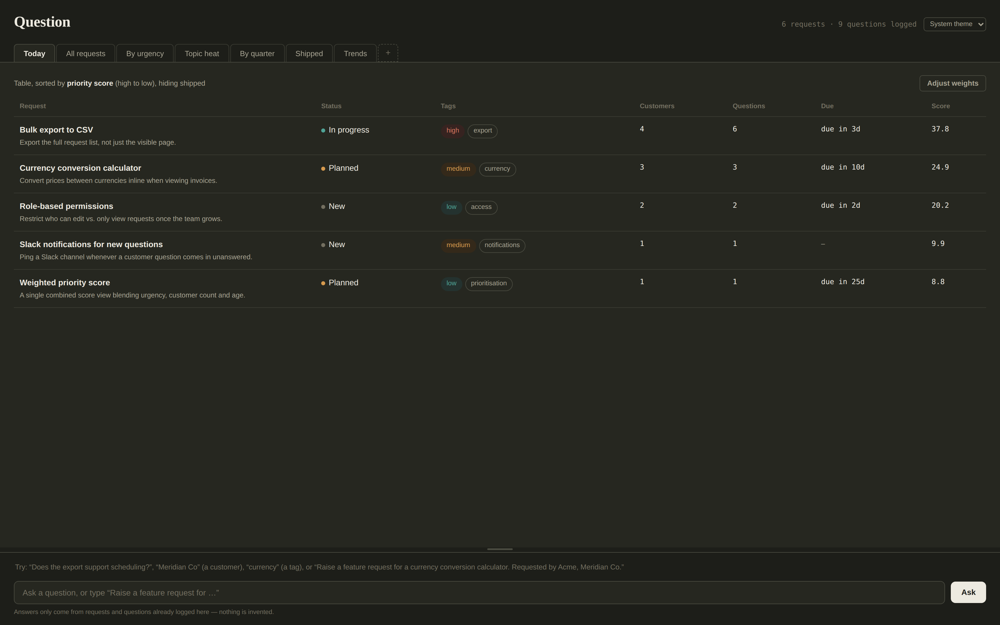
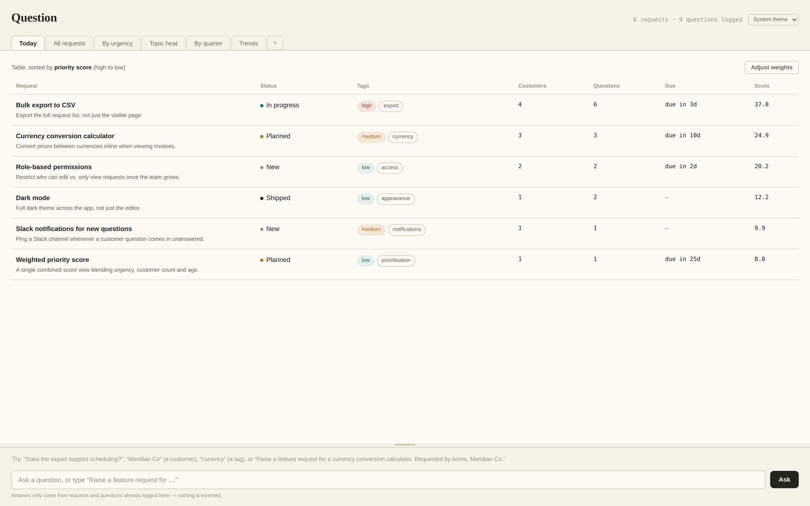

# Question

A lightweight desktop tool for product managers to keep feature requests and
customer questions in one ledger: track who's asking for what, spot
duplicate asks before they become duplicate work, see which topics keep
coming up, and know what to work on next.

<p>
  
  
</p>

The **Today** view above: every open request ranked by a single adjustable
priority score, blending urgency, how many customers asked, how many
questions came in, age, and due-date proximity.

## What it does

- **Today view** — a single, adjustable priority score (urgency, customer
  count, question volume, age, due-date proximity) surfaces what to work on
  next, instead of a flat backlog.
- **Feature requests** — track status, urgency, topic, quarter, customers,
  and due date per request; raise a request straight from a logged question
  so duplicates get merged instead of re-created.
- **Questions** — log customer questions, match them to an existing request
  or leave them unmatched, and see which topics have unanswered questions
  piling up.
- **Trends** — cross-cutting views across requests and questions: topic
  heat, recurring themes without a tracked feature yet, customers by
  request count, and quarter-over-quarter shape.
- **Custom statuses & topics** — rename or delete the values you added,
  the same way for both.
- **Light / dark / system theme.**

## How question matching works

Typing a question into the composer tries, in order: an exact customer/topic
lookup, then a match against logged requests and previously-answered
questions, then (if it looks like "raise a feature request for...") a new
draft. The request/question match is plain keyword overlap — it stems your
words and counts how many also appear in a request's title and description
(or a previously-answered question's text) — not a semantic or AI match, so
it only finds things that share actual vocabulary with what you typed.

**Works well:**
- "Does the currency calculator support GBP?" → matches a request titled
  *Currency conversion calculator* on shared words like "currency"/"calculator".
- Typing a topic or customer name on its own, e.g. "Travel" or "Meridian Co"
  → lists every request under that topic or customer, rather than guessing
  one.

**Won't match:**
- A question that's conceptually about a topic but doesn't share any words
  with the requests in it — e.g. three Travel requests titled "Narribri",
  "Coffs Harbour", "London" won't match "Where do I want to travel to?",
  because none of those titles contain the word "travel" (and topic names
  are deliberately excluded from matching — see below).
- Paraphrases and synonyms in general — "Is dark theme available?" only
  matches a request literally about "dark" + "theme", not one about, say,
  "night mode".

**Why topic name isn't part of the match:** several requests can share one
topic, so if the topic word alone counted, a question merely containing
that word would arbitrarily "win" against one of them — a false-positive
pick when the honest answer is "here are all of them." That's exactly what
the topic/customer lookup above is for instead.

**In practice:** if you want every request under a topic rather than a
single guessed match, just type the topic's name (or the customer's name)
on its own.

The reasoning behind this and other non-obvious choices in the app is kept
in [docs/DESIGN.md](docs/DESIGN.md) — worth a look before "fixing" behavior
that turns out to be deliberate.

## How it's built


- **Renderer**: a single-file HTML/CSS/JS UI (`renderer/index.html`), no
  framework, no build step.
- **Backend**: plain Node.js (`src/backend.cjs`). Every request and question
  is a human-readable Markdown file with YAML frontmatter under `data/` —
  that's the actual source of truth, and it's yours: back it up, sync it,
  read it in a text editor, put it in your own git repo if you want.
- **Index**: a SQLite file (`data/index.sqlite`, via Node's built-in
  `node:sqlite`) is rebuilt from those Markdown files on every save. It's
  disposable — delete it and it comes back from the files alone, with
  nothing lost. This is what makes the cross-data Trends queries fast
  without turning the Markdown files into a "real" database you have to
  migrate.
- **Desktop shell**: Electron (`main.cjs` / `preload.cjs`), with
  `contextIsolation` on, `nodeIntegration` off, a sandboxed renderer, and a
  `contentSecurityPolicy` enforced both in the page and in the main
  process. The renderer only ever gets two calls across the bridge —
  `loadAll()` and `syncAll(...)` — everything else (parsing frontmatter,
  writing files, rebuilding the index) stays in the main process.

(See "Running it" below for where your data actually lives on disk.)

## Running it

```
npm install
npm start
```

The first time you run it, a `Question Data` folder is created inside your
**Documents** folder — that's where all your data actually lives (plain
Markdown files, human-readable, nothing hidden away in an app-support
folder), and it's seeded with a handful of example feature requests and
questions so there's something to look at right away.

That seeding only ever happens once — the true first time the app has ever
run on your machine. Updating the app's code later (a new download, a
`git pull`, whatever) never touches `Question Data` — your real data and the
app's code are entirely separate, so upgrading the app never risks your
data.

**To wipe everything and start clean, quit the app and delete the
`Question Data` folder, then relaunch.** There's no in-app button for this
— an always-visible, one-click, unrecoverable wipe sitting in the main UI
forever was judged too dangerous to keep (see docs/DESIGN.md), and this
achieves the same thing more safely: it takes a deliberate action outside
the app, and on most systems the deleted folder lands in the Trash/Recycle
Bin first rather than being gone immediately. You'll land on a genuinely
empty app, not the example data again — the example seed is a true, one-time
first-run affordance, not something a later reset brings back.

`npm run demo` runs a small end-to-end proof of the backend on its own
(seeds sample data, deletes the index, rebuilds it from the Markdown files,
and runs a few sample SQL queries against it) without needing Electron.

## Building installers

```
npm run dist
```

Uses `electron-builder` to produce an installer for whichever platform
you're running it on, in `release/` (electron-builder doesn't reliably
cross-build a mac installer from Windows or Linux, or vice versa). Tagged
pushes to this repo build all three — `.dmg` (mac), an NSIS installer
(Windows), and an AppImage (Linux) — automatically via GitHub Actions,
one platform per runner, and attach them to a GitHub Release — see
`.github/workflows/build.yml`.

## Status

Early and actively changing. Feedback from real use is exactly what shaped
most of what's here so far — bug reports and rough edges are welcome.

## License

MIT — see [LICENSE](LICENSE).
